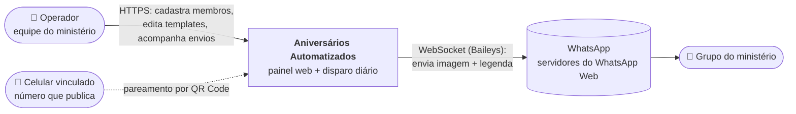
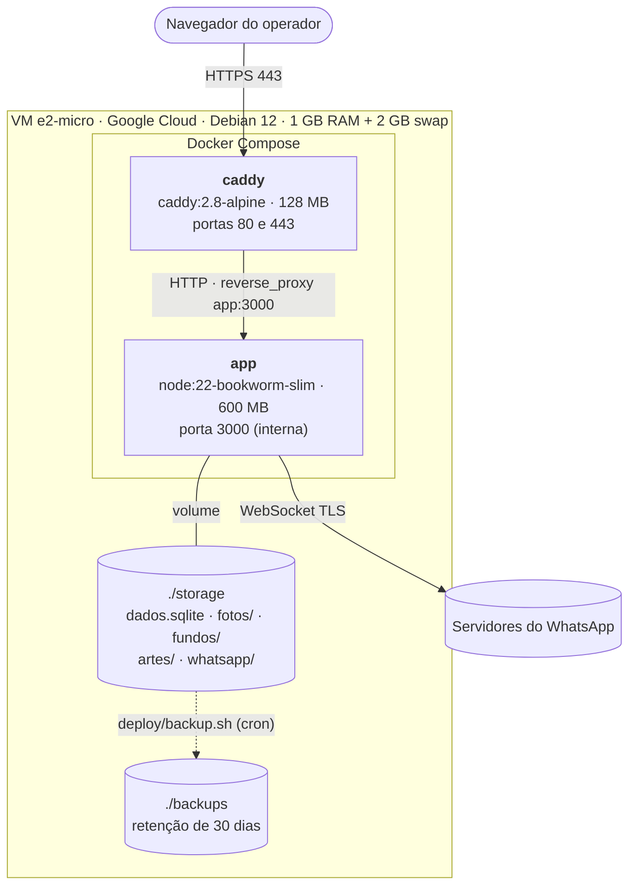
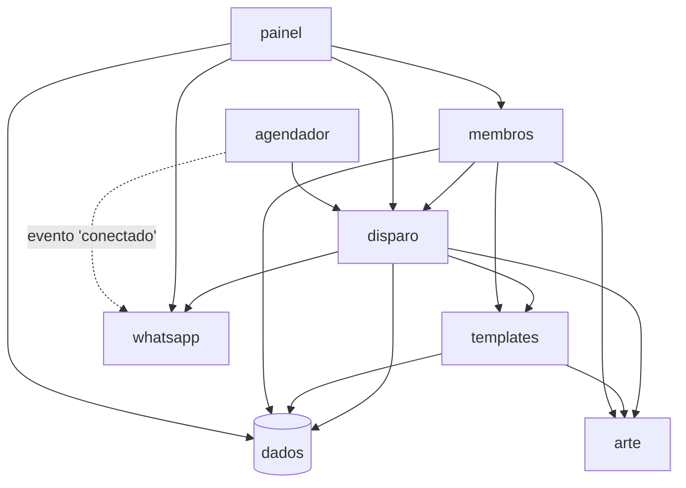
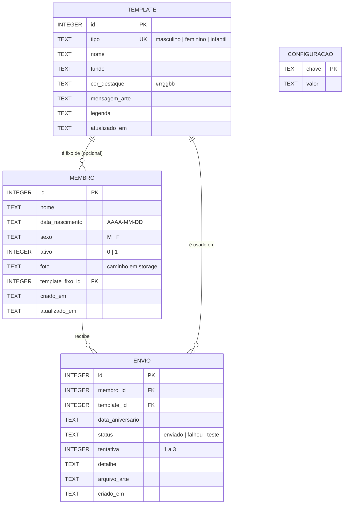
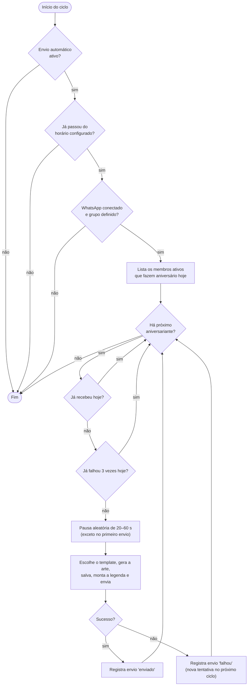
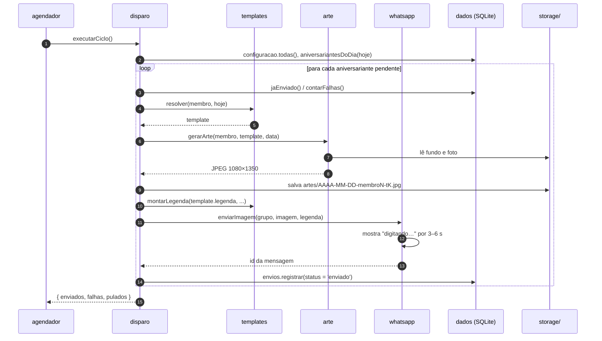
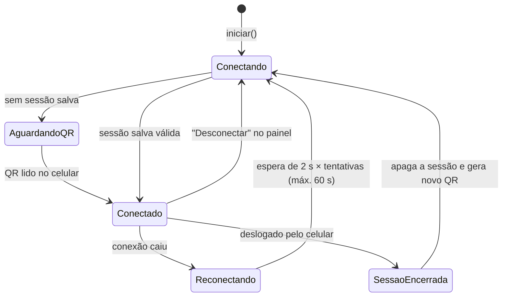

# Documento de Arquitetura — Aniversários Automatizados

| | |
| --- | --- |
| **Sistema** | Aniversários Automatizados — Ministério de Mídia |
| **Versão do documento** | 1.1 |
| **Última revisão** | 16/11/2026 |
| **Autor** | Iury Sousa dos Santos |
| **Status** | Vigente |

> Este documento descreve a arquitetura do sistema: o problema que ele resolve, as decisões
> tomadas, a organização do código, o modelo de dados, os fluxos principais e a operação em
> produção. As instruções de instalação e uso ficam no [`README.md`](../README.md).

## Sumário

1. [Introdução](#1-introdução)
2. [Requisitos e restrições](#2-requisitos-e-restrições)
3. [Contexto do sistema](#3-contexto-do-sistema)
4. [Decisões arquiteturais](#4-decisões-arquiteturais)
5. [Visão de implantação](#5-visão-de-implantação)
6. [Visão de componentes](#6-visão-de-componentes)
7. [Modelo de dados](#7-modelo-de-dados)
8. [Regras de negócio](#8-regras-de-negócio)
9. [Fluxos principais](#9-fluxos-principais)
10. [Interface web](#10-interface-web)
11. [Segurança](#11-segurança)
12. [Confiabilidade e operação](#12-confiabilidade-e-operação)
13. [Configuração](#13-configuração)
14. [Estratégia de testes](#14-estratégia-de-testes)
15. [Riscos e dívida técnica](#15-riscos-e-dívida-técnica)
16. [Questões em aberto](#16-questões-em-aberto)
17. [Glossário](#17-glossário)

---

## 1. Introdução

### 1.1 Propósito

No dia do aniversário de cada membro do Ministério de Mídia, o sistema gera uma arte
personalizada (foto, nome, mensagem e data) e a publica, com uma legenda, no grupo do WhatsApp
do ministério, sem intervenção manual.

### 1.2 Escopo

| Dentro do escopo | Fora do escopo |
| --- | --- |
| Cadastro de membros (nome, nascimento, sexo, situação, foto) | Múltiplos ministérios ou grupos simultâneos |
| Três templates de arte editáveis: masculino, feminino e infantil | Múltiplos usuários e perfis de acesso |
| Disparo automático diário, com novas tentativas e histórico | Canais de envio além do WhatsApp |
| Painel web com dashboard, histórico e configurações | Aplicativo móvel ou API pública |

### 1.3 Partes interessadas

| Parte interessada | Interesse |
| --- | --- |
| Equipe do ministério (operadores) | Cadastrar membros, ajustar artes e acompanhar os envios pelo painel |
| Membros do grupo do WhatsApp | Receber a homenagem no dia certo, uma única vez |
| Mantenedor | Operar e evoluir o sistema com baixo custo e pouca manutenção |

---

## 2. Requisitos e restrições

### 2.1 Requisitos funcionais

| ID | Requisito | Atendimento |
| --- | --- | --- |
| RF-01 | Manter o cadastro de membros com nome, data de nascimento, sexo, situação (ativo/inativo) e foto | Módulo `membros`, tela `/membros` com busca e filtros por sexo, situação e mês |
| RF-02 | Manter três templates de arte: masculino, feminino e infantil | Tabela `template` e tela `/templates`, com fundo, cor de destaque, frase e legenda editáveis |
| RF-03 | Escolher automaticamente o template de cada membro | Regra em `templates/regra.js` (ver [§8.1](#81-escolha-do-template)) |
| RF-04 | No aniversário, gerar a arte e enviá-la ao grupo do WhatsApp | Módulos `agendador`, `disparo`, `arte` e `whatsapp` |
| RF-05 | Registrar cada tentativa de envio e permitir consultar o histórico | Tabela `envio` e tela `/historico` |
| RF-06 | Exibir um dashboard com os aniversariantes e o estado do sistema | Tela `/`, montada por `painel/dashboard.js` |
| RF-07 | Permitir envio manual ("Enviar agora") e execução manual do ciclo | `POST /membros/:id/enviar` e `POST /configuracoes/ciclo` |

### 2.2 Requisitos não funcionais

| ID | Atributo | Requisito |
| --- | --- | --- |
| RNF-01 | Custo | Operar na camada gratuita do Google Cloud (VM e2-micro, 1 GB de RAM) |
| RNF-02 | Idempotência | Um membro nunca recebe duas artes no mesmo aniversário |
| RNF-03 | Resiliência | A falha de um envio não interrompe os demais; um reinício não perde o envio do dia |
| RNF-04 | Segurança | Painel acessível apenas com autenticação e somente por HTTPS |
| RNF-05 | Manutenibilidade | Uma única pessoa consegue manter o sistema; sem etapa de build no front-end |
| RNF-06 | Portabilidade | Implantação reproduzível com Docker Compose |

### 2.3 Restrições

- **Infraestrutura:** 1 vCPU compartilhada e 1 GB de RAM. O processo Node é limitado a 384 MB de
  heap, e o contêiner, a 600 MB.
- **Integração com o WhatsApp:** não há API oficial gratuita para postar em grupos. A única opção
  viável é o Baileys, uma biblioteca JavaScript que implementa o protocolo do WhatsApp Web.
- **Fuso horário:** todas as datas são interpretadas em `America/Sao_Paulo`.

---

## 3. Contexto do sistema



O sistema tem um único ator humano, o operador, e uma única integração externa, o WhatsApp. O
número que publica é vinculado uma vez, lendo o QR Code exibido em **Configurações**, como em um
dispositivo do WhatsApp Web.

---

## 4. Decisões arquiteturais

Cada decisão segue o formato contexto → decisão → consequências.

### DA-01 — Monólito modular

- **Contexto:** um mantenedor, uma VM de 1 GB e um domínio pequeno.
- **Decisão:** um único processo Node.js, dividido em módulos com interfaces públicas pequenas.
- **Consequências:** um deploy, um log e nenhuma comunicação entre serviços. As fronteiras entre
  os módulos permitem trocar uma parte (por exemplo, o canal de envio) sem afetar as outras.

### DA-02 — Node.js 22 + Express 5

- **Contexto:** o Baileys só existe em JavaScript.
- **Decisão:** todo o sistema em Node.js, com ES Modules e Express 5.
- **Consequências:** uma linguagem só e o WhatsApp embutido no mesmo processo, sem um segundo
  serviço. Express 5 trata nativamente erros de rotas `async`.

### DA-03 — Renderização no servidor com Eta e htmx

- **Contexto:** as telas são formulários e listagens simples.
- **Decisão:** HTML gerado no servidor com templates Eta, e htmx para interações pontuais (busca
  incremental, status do QR Code, botões de envio).
- **Consequências:** sem SPA, sem bundler e sem etapa de build. O htmx é servido diretamente de
  `node_modules`.

### DA-04 — SQLite embarcado

- **Contexto:** volume de dados pequeno (dezenas a centenas de membros) e um único processo
  escrevendo.
- **Decisão:** SQLite via `better-sqlite3` (API síncrona), em modo WAL, com chaves estrangeiras
  ativas. As imagens ficam no sistema de arquivos, em `storage/`.
- **Consequências:** nenhum servidor de banco para operar, e o backup é uma cópia de arquivo. A
  aplicação não escala horizontalmente, o que é aceitável neste contexto.

### DA-05 — Geração de imagem com sharp e SVG

- **Contexto:** a arte combina fundo, foto recortada em círculo e textos.
- **Decisão:** os textos e formas são desenhados em SVG e compostos sobre o fundo com o `sharp`
  (libvips). A saída é um JPEG de 1080×1350 px (proporção 4:5).
- **Consequências:** baixo uso de memória e nenhuma dependência de navegador headless. O cache
  e a concorrência do sharp ficam desligados para caber em 1 GB.

### DA-06 — Agendamento interno por ciclos

- **Contexto:** o envio precisa sobreviver a reinícios e a quedas temporárias do WhatsApp.
- **Decisão:** em vez de um cron num horário exato, um ciclo idempotente roda a cada 15 minutos e
  só age depois do horário configurado.
- **Consequências:** o envio do dia é recuperado automaticamente após um reinício ou uma
  reconexão, e as falhas ganham novas tentativas nos ciclos seguintes.

### DA-07 — Docker Compose + Caddy

- **Contexto:** HTTPS obrigatório, sem custo e com pouca configuração.
- **Decisão:** dois contêineres, a aplicação e o Caddy como proxy reverso, que emite e renova o
  certificado Let's Encrypt automaticamente.
- **Consequências:** o deploy se resume a `docker compose up -d --build`.

---

## 5. Visão de implantação



| Elemento | Detalhe |
| --- | --- |
| Imagem da aplicação | Build em dois estágios: o primeiro compila os módulos nativos (`better-sqlite3`, `sharp`) e o segundo leva só o necessário, mais as fontes DejaVu e o `tzdata` |
| Usuário | O contêiner roda como `node` (uid 1000), sem privilégios de root |
| Healthcheck | `GET /saude` a cada minuto |
| Persistência | `./storage` montado em `/app/storage`. Certificados do Caddy em volumes nomeados |
| Fuso horário | `TZ=America/Sao_Paulo` na imagem e na VM |

### 5.1 Estrutura de `storage/`

| Caminho | Conteúdo | Servido pelo painel? |
| --- | --- | --- |
| `dados.sqlite` (+ `-wal`, `-shm`) | Banco de dados | Não |
| `fotos/` | Fotos dos membros, 800×800 JPEG | Sim, autenticado |
| `fundos/` | Fundos dos templates, 1080×1350 JPEG | Sim, autenticado |
| `artes/` | Artes geradas, uma por tentativa | Sim, autenticado |
| `whatsapp/` | Credenciais da sessão do WhatsApp | **Nunca** |

---

## 6. Visão de componentes

### 6.1 Organização do código

```
src/
├── server.js            Inicialização: storage, banco, HTTP, WhatsApp, agendador, encerramento
├── app.js               Express: cabeçalhos de segurança, sessão, autenticação, rotas, erros
├── config.js            Leitura e validação das variáveis de ambiente
├── lib/
│   ├── datas.js         Datas ISO, idade, aniversário (com a regra de 29/02)
│   ├── upload.js        Multer em memória (imagens de até 10 MB)
│   └── views.js         Motor Eta, helpers de formatação, detecção de requisição htmx
└── modulos/
    ├── dados/           Conexão, migrações, valores padrão e repositórios
    ├── membros/         Validação, campos calculados e rotas /membros
    ├── templates/       Regra de escolha, legenda e rotas /templates
    ├── arte/            Geração e normalização de imagens
    ├── whatsapp/        Conexão Baileys e envio
    ├── disparo/         Ciclo de envio e "Enviar agora"
    ├── agendador/       Temporizador dos ciclos
    └── painel/          Autenticação, dashboard, histórico e configurações
```

### 6.2 Dependências entre módulos



As dependências seguem um único sentido: das camadas de entrada (`painel`, rotas de `membros` e
`templates`, `agendador`) para a orquestração (`disparo`), e daí para os serviços (`arte`,
`whatsapp`, `templates`) e para a persistência (`dados`). `arte` e `whatsapp` não dependem do
banco, o que os mantém reutilizáveis e fáceis de testar.

### 6.3 Responsabilidades e interfaces públicas

| Módulo | Responsabilidade | Interface pública |
| --- | --- | --- |
| `dados` | Abrir o SQLite, aplicar migrações versionadas (`PRAGMA user_version`), semear templates e configurações padrão e expor os repositórios | `abrir`, `fechar`, `getDb`, `membros`, `templates`, `envios`, `configuracao` |
| `membros` | Validar o formulário, calcular idade, próximo aniversário, dias restantes e template previsto | `validar`, `listarDetalhado`, `detalhar`, `rotasMembros` |
| `templates` | Aplicar a regra de escolha e montar a legenda com as variáveis | `escolherTemplate`, `criarResolvedor`, `montarLegenda`, `rotasTemplates` |
| `arte` | Compor a arte e normalizar as imagens enviadas | `gerarArte`, `miniatura`, `salvarImagem`, `removerArquivo` |
| `whatsapp` | Manter a conexão, gerar o QR Code, reconectar e enviar | `iniciar`, `status`, `enviarImagem`, `listarGrupos`, `desconectar`, `eventos` |
| `disparo` | Decidir quem recebe, gerar, enviar e registrar cada tentativa | `executarCiclo`, `enviarAgora`, `enviarParaMembro`, `infoUltimoCiclo` |
| `agendador` | Disparar ciclos periodicamente e após a conexão do WhatsApp | `iniciar`, `parar`, `proximoCiclo` |
| `painel` | Login, dashboard, histórico e configurações | `rotasAuth`, `exigirLogin`, `rotasPainel` |

**Pontos de extensão.** O `disparo` recebe o canal de envio por injeção (`usarCanal`), e qualquer
objeto com `status()` e `enviarImagem(jid, imagem, legenda)` serve. Os testes usam um canal falso,
e trocar o Baileys por outra solução afeta só o módulo `whatsapp`. A pausa entre envios também é
injetável (`usarPausa`).

---

## 7. Modelo de dados

### 7.1 Diagrama entidade-relacionamento



### 7.2 Dicionário de dados

**`membro`**

| Coluna | Tipo | Nulo | Regras |
| --- | --- | --- | --- |
| `id` | INTEGER | Não | Chave primária |
| `nome` | TEXT | Não | Não vazio (`CHECK`). A aplicação limita a 120 caracteres e normaliza os espaços |
| `data_nascimento` | TEXT | Não | ISO `AAAA-MM-DD` (`CHECK` com `GLOB`), ano a partir de 1900 e nunca no futuro |
| `sexo` | TEXT | Não | `M` ou `F` |
| `ativo` | INTEGER | Não | `0` ou `1`, padrão `1`. Membro inativo não recebe arte |
| `foto` | TEXT | Sim | Caminho relativo em `storage/fotos`. Sem foto, a arte mostra as iniciais |
| `template_fixo_id` | INTEGER | Sim | FK para `template`, `ON DELETE SET NULL`. Exceção à regra automática |
| `criado_em`, `atualizado_em` | TEXT | Não | Preenchidos pelo sistema, no horário local |

**`template`**

| Coluna | Tipo | Nulo | Regras |
| --- | --- | --- | --- |
| `id` | INTEGER | Não | Chave primária |
| `tipo` | TEXT | Não | Único: `masculino`, `feminino` ou `infantil`. Os três são criados na primeira execução |
| `nome` | TEXT | Não | Nome exibido no painel |
| `fundo` | TEXT | Sim | Imagem 1080×1350 em `storage/fundos`. Sem fundo, usa-se o gradiente padrão |
| `cor_destaque` | TEXT | Não | Hexadecimal `#rrggbb`. Colore o título, o anel da foto e a data |
| `mensagem_arte` | TEXT | Não | Frase impressa na arte, até 2 linhas |
| `legenda` | TEXT | Não | Texto da mensagem no WhatsApp, com variáveis (ver [§8.2](#82-legenda-do-whatsapp)) |
| `atualizado_em` | TEXT | Não | Preenchido pelo sistema |

**`envio`**

| Coluna | Tipo | Nulo | Regras |
| --- | --- | --- | --- |
| `id` | INTEGER | Não | Chave primária |
| `membro_id` | INTEGER | Não | FK para `membro`, `ON DELETE CASCADE` |
| `template_id` | INTEGER | Sim | FK para `template`: qual arte foi usada |
| `data_aniversario` | TEXT | Não | Dia do aniversário a que o envio se refere |
| `status` | TEXT | Não | `enviado`, `falhou` ou `teste` |
| `tentativa` | INTEGER | Não | De 1 a 3 |
| `detalhe` | TEXT | Sim | ID da mensagem no WhatsApp ou a mensagem de erro |
| `arquivo_arte` | TEXT | Sim | Caminho da arte gerada em `storage/artes` |
| `criado_em` | TEXT | Não | Momento da tentativa |

**`configuracao`** é um repositório chave → valor. As chaves ausentes assumem os valores padrão
definidos em `CONFIG_PADRAO` (ver [§13.2](#132-configurações-do-painel)).

### 7.3 Índices e integridade

| Índice | Definição | Finalidade |
| --- | --- | --- |
| `uq_envio_enviado` | `UNIQUE (membro_id, data_aniversario) WHERE status = 'enviado'` | Garante **no banco** que um membro não recebe duas artes no mesmo aniversário (RNF-02) |
| `idx_envio_membro_data` | `(membro_id, data_aniversario)` | Consulta de "já enviado" e contagem de falhas durante o ciclo |
| `idx_envio_criado` | `(criado_em)` | Ordenação do histórico |

### 7.4 Migrações

As migrações ficam no array `MIGRACOES` em `dados/index.js`. A versão aplicada é guardada em
`PRAGMA user_version`, e cada migração roda numa transação. Para evoluir o esquema, acrescente
um novo item ao final do array, sem nunca alterar os existentes.

---

## 8. Regras de negócio

### 8.1 Escolha do template

As condições são avaliadas em ordem, e vale a primeira verdadeira:

| Ordem | Condição | Template |
| --- | --- | --- |
| 1 | O membro tem um template fixo válido | O template fixo |
| 2 | Idade no dia do aniversário < `idade_limite_infantil` (padrão 12) | Infantil |
| 3 | Sexo = `F` | Feminino |
| 4 | Caso contrário (sexo = `M`) | Masculino |

- **Idade** é o número de anos completos na data do aniversário a que a arte se refere. Assim, quem
  faz 12 anos hoje já recebe a arte adulta.
- **Template fixo** atende exceções, como uma criança de 11 anos que prefere a arte adulta.
- **Template sem fundo** usa um gradiente gerado a partir da cor de destaque. O envio nunca falha
  por falta de fundo.

### 8.2 Legenda do WhatsApp

A legenda aceita as variáveis abaixo, substituídas no momento do envio:

| Variável | Valor | Exemplo |
| --- | --- | --- |
| `{nome}` | Nome do membro | `Maria da Silva` |
| `{idade}` | Idade completada | `28` |
| `{data}` | Dia e mês por extenso | `16 de novembro` |
| `{ministerio}` | Configuração `nome_ministerio` | `Ministério de Mídia` |

### 8.3 Datas

- Todas as datas trafegam como texto ISO `AAAA-MM-DD`, interpretadas no fuso do processo (`TZ`).
- **Nascidos em 29/02** são homenageados em 28/02 nos anos não bissextos.
- A data de nascimento exige o ano completo, porque a idade decide o template infantil.

### 8.4 Composição da arte

```
┌──────────────────────────────┐  1080 × 1350 px, JPEG (qualidade 88, mozjpeg)
│   ( Feliz Aniversário! )     │  faixa branca com o título na cor de destaque
│                              │
│          ╭───────╮           │  foto circular (r = 270 px) com anel duplo
│          │ FOTO  │           │  sem foto: círculo claro com as iniciais
│          ╰───────╯           │
│ ┌──────────────────────────┐ │
│ │     NOME DO MEMBRO       │ │  tamanho da fonte ajustado ao comprimento do nome
│ │  mensagem da arte (2 l.) │ │
│ │      16 de novembro      │ │  data na cor de destaque
│ │   Ministério de Mídia    │ │
│ └──────────────────────────┘ │
└──────────────────────────────┘
```

Os textos são escapados antes de entrar no SVG, e os caminhos de arquivo são confinados a
`storage/` para impedir path traversal.

---

## 9. Fluxos principais

### 9.1 Ciclo de disparo

O `agendador` executa o ciclo a cada `INTERVALO_CICLO_MIN` minutos (padrão 15), 10 segundos após a
inicialização e 5 segundos após cada conexão do WhatsApp. Os ciclos nunca se sobrepõem: o próximo
só é agendado quando o anterior termina, e uma trava (`emExecucao`) descarta chamadas concorrentes.



### 9.2 Envio de uma arte



### 9.3 "Enviar agora"

O botão do cadastro do membro segue esta regra:

- **No dia do aniversário**, com o membro ativo, ainda sem envio e com menos de 3 falhas: o envio
  conta como o envio oficial do dia (`status = 'enviado'`), e o ciclo automático não o repete.
- **Em qualquer outro caso**: a arte do próximo aniversário é enviada como teste
  (`status = 'teste'`), sem interferir no envio automático.

### 9.4 Conexão do WhatsApp



A sessão fica em `storage/whatsapp/`, e por isso a conexão sobrevive a reinícios. Ao conectar, o
módulo emite o evento `conectado`, que dispara um ciclo e recupera envios pendentes.

---

## 10. Interface web

Todas as telas, exceto `/login` e `/saude`, exigem autenticação.

| Método | Rota | Descrição |
| --- | --- | --- |
| GET | `/saude` | Healthcheck (`{ "ok": true }`), público |
| GET, POST | `/login` | Autenticação |
| POST | `/logout` | Encerra a sessão |
| GET | `/` | Dashboard |
| GET | `/membros` | Lista com busca e filtros. Em requisições htmx, devolve só as linhas |
| GET | `/membros/novo` | Formulário de cadastro |
| POST | `/membros` | Cria um membro |
| GET, POST | `/membros/:id` | Exibe e atualiza um membro |
| POST | `/membros/:id/excluir` | Exclui o membro, sua foto e seu histórico |
| GET | `/membros/:id/previa.jpg` | Prévia da arte do próximo aniversário (`?w=` para miniatura) |
| POST | `/membros/:id/enviar` | "Enviar agora" (fragmento htmx) |
| GET | `/templates` | Os três templates lado a lado |
| POST | `/templates/:id` | Atualiza um template, incluindo o fundo |
| GET | `/templates/:id/previa.jpg` | Prévia com um membro fictício |
| GET | `/historico` | Envios paginados (50 por página), com filtro por status |
| GET, POST | `/configuracoes` | WhatsApp, grupo, horário, idade limite e nome do ministério |
| GET | `/configuracoes/whatsapp` | Fragmento com o QR Code e o status (consultado pelo htmx) |
| POST | `/configuracoes/whatsapp/desconectar` | Encerra a sessão e gera um novo QR Code |
| POST | `/configuracoes/ciclo` | Executa um ciclo imediatamente, ignorando o horário |
| GET | `/storage/{fotos,fundos,artes}/*` | Imagens, apenas com autenticação |

### 10.1 Dashboard

| Indicador | Conteúdo |
| --- | --- |
| Aniversariantes de hoje | Prévia da arte, template escolhido e situação (aguardando, enviado ou falhou) |
| Próximos 7 dias | Nome, data e dias restantes |
| Aniversariantes do mês | Quantidade e lista em ordem de dia |
| Membros | Total de ativos e inativos |
| Membros por template | Distribuição prevista entre masculino, feminino e infantil |
| Saúde do sistema | WhatsApp conectado, grupo configurado e próximo envio |
| Últimos envios | Os cinco mais recentes, com as falhas em destaque |

---

## 11. Segurança

| Ameaça | Controle |
| --- | --- |
| Acesso não autorizado ao painel | Login obrigatório em todas as rotas, exceto `/login` e `/saude` |
| Força bruta no login | Bloqueio por IP após 5 erros em 15 minutos (HTTP 429) |
| Timing attack na comparação de credenciais | Comparação de hashes SHA-256 em tempo constante (`timingSafeEqual`) |
| Roubo ou adulteração de sessão | Cookie assinado com `SESSAO_SEGREDO`, `HttpOnly`, `SameSite=Lax` e `Secure` em produção |
| CSRF | `SameSite=Lax` impede que outros sites enviem POSTs com o cookie de sessão |
| Interceptação de tráfego | HTTPS obrigatório via Caddy (Let's Encrypt) |
| Clickjacking e MIME sniffing | `X-Frame-Options: DENY`, `X-Content-Type-Options: nosniff`, `Referrer-Policy: same-origin` |
| XSS | Escape automático nos templates Eta e escape explícito nos textos do SVG |
| Path traversal | Caminhos de arquivo resolvidos e confinados a `storage/` |
| Upload malicioso | Apenas tipos de imagem, até 10 MB. Toda imagem é decodificada e regravada como JPEG pelo sharp |
| Vazamento da sessão do WhatsApp | `storage/whatsapp/` e o banco nunca são servidos via HTTP |
| Credenciais fracas em produção | O processo não inicia sem `ADMIN_SENHA` e `SESSAO_SEGREDO` definidos |
| SQL injection | Todas as consultas usam parâmetros nomeados (prepared statements) |
| Escalada no contêiner | A aplicação roda como usuário sem privilégios (`node`) |

---

## 12. Confiabilidade e operação

### 12.1 Garantias de entrega

| Garantia | Mecanismo |
| --- | --- |
| No máximo um envio por aniversário | Consulta `jaEnviado` antes de enviar e índice único parcial `uq_envio_enviado` no banco |
| Novas tentativas limitadas | Até 3 tentativas por membro e por dia, uma por ciclo |
| Isolamento de falhas | Cada membro é processado num `try/catch` próprio: uma falha é registrada e o ciclo segue |
| Recuperação após reinício | O ciclo roda 10 s após a inicialização e envia o que estiver pendente no dia |
| Recuperação após queda do WhatsApp | Reconexão automática com espera crescente e um ciclo logo após conectar |
| Comportamento natural no grupo | Pausa de 20 a 60 s entre envios e indicador "digitando…" antes de cada um |

### 12.2 Uso de recursos

- O sharp processa uma imagem por vez, sem cache.
- O heap do Node é limitado a 384 MB, e o contêiner, a 600 MB. O Caddy usa até 128 MB.
- A VM recebe 2 GB de swap, necessários para o build da imagem.

### 12.3 Ciclo de vida do processo

1. Valida as variáveis de ambiente obrigatórias.
2. Cria as pastas de `storage/`.
3. Abre o banco e aplica as migrações e os valores padrão.
4. Inicia o servidor HTTP, o WhatsApp e o agendador.
5. Ao receber `SIGTERM` ou `SIGINT`: para o agendador, fecha o servidor HTTP e o banco e encerra.
   Se isso demorar mais de 5 s, o encerramento é forçado.

### 12.4 Observabilidade

| Sinal | Onde |
| --- | --- |
| Logs da aplicação | `docker compose logs app` (resumo de cada ciclo com envios e erros) |
| Logs do Baileys | Nível controlado por `WHATSAPP_LOG` (padrão `warn`) |
| Saúde do contêiner | Healthcheck do Docker em `/saude` |
| Saúde funcional | Painel "Saúde do sistema" no dashboard e tela de histórico |

### 12.5 Backup e restauração

- **Backup:** `deploy/backup.sh`, agendado no cron da VM (sugestão: diário às 03:00). Usa a API de
  backup online do SQLite, que gera uma cópia consistente mesmo com a aplicação rodando, e
  compacta `fotos/` e `fundos/`. Mantém 30 dias em `backups/`.
- **Restauração:** pare a aplicação, copie `dados.sqlite` e extraia `imagens.tar.gz` em `storage/`
  e suba novamente. As artes geradas não entram no backup, porque podem ser regeradas. A sessão do
  WhatsApp também não entra: depois de uma restauração em outra máquina, basta ler o QR Code de novo.

### 12.6 Atualização

```bash
git pull && sudo docker compose up -d --build
```

As migrações do banco rodam automaticamente na inicialização.

---

## 13. Configuração

### 13.1 Variáveis de ambiente

| Variável | Obrigatória | Padrão | Descrição |
| --- | --- | --- | --- |
| `ADMIN_USUARIO` | Não | `admin` | Usuário do painel |
| `ADMIN_SENHA` | Em produção | `admin` (só em desenvolvimento) | Senha do painel |
| `SESSAO_SEGREDO` | Em produção | valor fixo de desenvolvimento | Chave de assinatura do cookie de sessão |
| `DOMINIO` | Em produção | — | Domínio usado pelo Caddy para emitir o certificado |
| `PORTA` | Não | `3000` | Porta HTTP da aplicação |
| `STORAGE_DIR` | Não | `./storage` | Diretório de dados |
| `INTERVALO_CICLO_MIN` | Não | `15` | Intervalo entre ciclos, em minutos |
| `WHATSAPP_DESATIVADO` | Não | — | `1` desliga o WhatsApp (desenvolvimento) |
| `WHATSAPP_LOG` | Não | `warn` | Nível de log do Baileys |
| `COOKIE_INSEGURO` | Não | — | `1` permite o cookie sem HTTPS em produção (só para diagnóstico) |
| `NODE_ENV` | Não | — | `production` ativa cache de views, cookie seguro e exige as credenciais |
| `TZ` | Sim | `America/Sao_Paulo` na imagem | Fuso horário de todas as datas |

### 13.2 Configurações do painel

Ficam na tabela `configuracao` e podem ser alteradas em `/configuracoes`, sem reiniciar.

| Chave | Padrão | Validação |
| --- | --- | --- |
| `envio_ativo` | `1` | `0` ou `1` |
| `grupo_whatsapp` | — | JID do grupo, escolhido numa lista |
| `grupo_whatsapp_nome` | — | Preenchido automaticamente |
| `horario_envio` | `08:00` | `HH:MM`, 24 horas |
| `idade_limite_infantil` | `12` | Inteiro de 1 a 18 |
| `nome_ministerio` | `Ministério de Mídia` | Não vazio |

---

## 14. Estratégia de testes

Os testes usam o runner nativo do Node (`node:test`), sem dependências extras, e rodam com
`TZ=America/Sao_Paulo` para resultados determinísticos.

| Suíte | Cobertura |
| --- | --- |
| `test/datas.test.js` | Idade, próximo aniversário, 29/02 em ano bissexto e não bissexto, validação de datas |
| `test/regra.test.js` | Ordem da regra de templates, limite infantil, template fixo, montagem da legenda |
| `test/disparo.test.js` | Ciclo completo com banco em memória e canal de envio falso: horário, idempotência (na aplicação e no índice único), limite de 3 falhas, recuperação após falha e dimensões da arte sem foto e sem fundo |

```bash
npm test   # 16 testes
```

Lacunas conhecidas: "Enviar agora", rotas HTTP e reconexão do WhatsApp ainda não têm testes automatizados.

O design favorece a testabilidade: as funções de data recebem "agora" e "hoje" como parâmetro, o
canal de envio e a pausa são injetáveis, e a regra de templates é uma função pura.

---

## 15. Riscos e dívida técnica

| ID | Risco | Probabilidade | Impacto | Mitigação |
| --- | --- | --- | --- | --- |
| R-01 | O Baileys usa um protocolo não oficial: o número pode ser bloqueado ou a biblioteca pode quebrar com mudanças do WhatsApp | Média | Alto | Volume baixo (poucas mensagens por dia), pausas e "digitando…". Usar um número dedicado. O canal é isolado no módulo `whatsapp` e pode ser trocado |
| R-02 | Ponto único de falha: uma VM, um processo e um disco | Média | Médio | Reinício automático (`restart: unless-stopped`), ciclo de recuperação e backup diário |
| R-03 | "Enviar agora" e o ciclo automático podem coincidir para o mesmo membro, gerando uma mensagem duplicada no grupo (o índice único impede só o registro duplicado) | Baixa | Baixo | Estender a trava do ciclo ao "Enviar agora" ou verificar `jaEnviado` sob a trava |
| R-04 | O controle de tentativas de login fica em memória: é zerado a cada reinício e o mapa de IPs não é limpo periodicamente | Baixa | Baixo | Aceitável para um único operador. Pode virar uma limpeza periódica ou passar para o banco |
| R-05 | Um único usuário administrador, sem trilha de auditoria por pessoa | Baixa | Baixo | Fora do escopo atual. Uma tabela `usuario` resolveria |
| R-06 | As artes geradas acumulam em `storage/artes/` indefinidamente | Alta | Baixo | Cerca de 200 KB por arte, um volume desprezível no curto prazo. Pode ganhar uma rotina de limpeza |
| R-07 | Uma mudança de horário configurada depois do horário antigo não reenvia nem pula envios; vale a nova regra a partir do próximo ciclo | Baixa | Baixo | Comportamento esperado, documentado aqui |

---

## 16. Questões em aberto

| Questão | Situação atual |
| --- | --- |
| Até que idade a arte é infantil? | Padrão: abaixo de 12 anos, ajustável em Configurações (1 a 18) |

---

## 17. Glossário

| Termo | Definição |
| --- | --- |
| **Arte** | Imagem JPEG 1080×1350 gerada para o aniversariante |
| **Baileys** | Biblioteca JavaScript que implementa o protocolo do WhatsApp Web |
| **Ciclo** | Uma execução do disparo, que avalia e envia as artes pendentes do dia |
| **Envio** | Registro de uma tentativa de postagem (`enviado`, `falhou` ou `teste`) |
| **JID** | Identificador de um contato ou grupo no WhatsApp (por exemplo, `1203…@g.us`) |
| **Legenda** | Texto da mensagem do WhatsApp que acompanha a arte |
| **Template** | Conjunto de fundo, cor, frase e legenda usado para gerar a arte |
| **Template fixo** | Template escolhido manualmente para um membro, acima da regra automática |
| **WAL** | Write-Ahead Logging, modo do SQLite que permite leituras durante as escritas |
